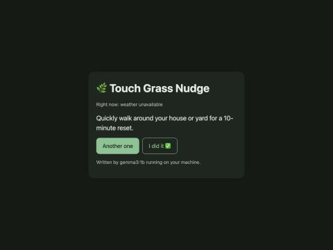

# Touch Grass Nudge

One HTML file. Reads your local weather (Open-Meteo, no key), asks a local open-weight model (Gemma via Ollama) for a 10-minute outdoor micro-quest, and tracks completed quests in your browser. No backend, no account, nothing leaves your machine except the weather lookup.

```bash
ollama pull gemma3:1b
OLLAMA_ORIGINS="http://localhost:8000" ollama serve   # allow this page to call Ollama
python3 -m http.server 8000                           # then open http://localhost:8000
```

Use `?model=<name>` to try another model. If Ollama isn't reachable it falls back to built-in quests.



License: MIT
